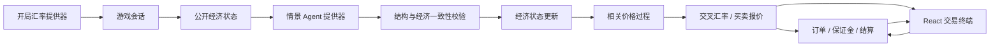

# 架构与下一阶段

## 前端选择

| 方案                      | 适用场景                         | 本项目选择                                        |
| ------------------------- | -------------------------------- | ------------------------------------------------- |
| 原生 HTML / JS            | 简单单页展示                     | 交易状态、图表、事件与账户复杂后维护成本高        |
| React + TypeScript + Vite | 网页、响应式手机浏览器、未来 PWA | 当前方案；组件化 UI，业务逻辑留在后端             |
| Taro / uni-app            | 明确优先微信等小程序平台         | 暂不采用；普通 React DOM 页面不能直接转换为小程序 |
| Tauri / Capacitor         | 桌面、移动端外壳                 | 后续可复用 Web 前端，仍需要平台适配               |

当前没有实现 PWA 离线模式或小程序打包。小程序可复用 HTTP 接口与 TypeScript 契约，但图表、存储和页面需要适配。交易终端使用轻量 SVG K 线，避免在第一阶段绑定第三方图表服务。

## 数据流

客户端没有成交定价权，不能提交自定义成交价或账户余额。市场随机源与事件随机源分离，Agent 输入不包含账户、仓位、未来随机序列或用户敏感信息。玩家仓位不影响市场方向。

## 两个可替换的接口

### BaselineProvider

`load(): Promise<MarketBaseline>` 返回美元为统一计价单位的货币价值：`USD=1`，`EUR=1.085` 表示 1 欧元值 1.085 美元。新会话调用一次，随后世界独立运行。已实现 `DemoBaselineProvider` 和 `TwelveDataBaselineProvider`；真实提供器在服务端启动时创建并跨会话共享。

Twelve Data 适配器已实现：

1. 在服务端读取凭据，统一限流和缓存，避免每名玩家重复消耗上游额度。
2. 验证币种覆盖、值域、来源、时间戳与数据新鲜程度；缺失数据不伪装成当天数据。
3. 将各报价方向转换为统一 USD 单位；检查完整快照的时间偏差。
4. 只初始化新世界；新参考价格不能覆盖进行中的模拟状态。
5. 返回原始直盘、close、逐币种 K 线时间、获取时间、开局时年龄和缓存状态。真实快照原子校验，不拿演示币种补洞。超过 96 小时拒绝新局，超过 2 小时明确提示；单局快照固定不变。

当前开局图表仍是合成前史，即使换成真实起点，也不能冒充真实历史 K 线。日频历史档案已独立保存和展示，参数校准仍待实施。配置和数据策略见 [reference-data.md](reference-data.md)。

`createApp({ baseline })` 可以注入实现。`createWorld` 校验正数有限汇率及 USD=1；合成前史整体重定基准，让开局价精确匹配输入。

### ScenarioProvider

`propose(observation, context): Promise<unknown>` 返回事件提议。`observation` 是经济体公开状态和已发生的事件，`context` 是服务端选择的目标、事件类别与冲击强度。当前实现 `LocalScenarioProvider`，它不是大语言模型。导演现在还读取内部经济，支持工业景气、信贷条件和财政事件；所有经济体另外拥有独立于事件抽样频率的每日内部观察。

Agent 是独立的模块，不是夹在价格公式里的随机文案。当前流程：

1. 导演根据模拟时间安排报告，以经济影响权重选择目标经济体。
2. 提供器读取状态、全球能源/风险指标、贸易关系和事件记忆，生成有类型的标题、描述、预期值与结果；实际变量变化由引擎按事件类型计算。
3. Zod 拒绝额外字段、非法类型和超出边界的冲击。
4. 语义校验确认目标与排程一致，预期与现有状态一致，实际差值未超出该事件类型的边界；不接受任意 impact 字段。
5. 合格事件改变经济状态与利率预期，行情引擎据此重估；不合格事件丢弃并显示导演状态。

外部模型不得直接写价格、余额或调用交易函数。外部实现使用独立的 `AgentProvider.generate` 接口，已有 OpenAI 兼容适配器、后台工作队列、超时、取消、调用预算、并发限制、状态重校验和本地降级。网络请求不占用交易队列，暂停时生成结果只等待，游戏时间推进后才处理。模型输出视为不可信数据，失败和来源均有记录；详细配置见 [event-director.md](event-director.md)。本地 `ScenarioProvider` 仍立即返回并串行执行。

事件契约按 `topic` 区分通胀预期、增长预期、供应链、信心、能源和央行决议，分别规定种类、数值范围和一致性规则。央行决议由引擎在预定会议生成；Agent 不能提前改变实际政策利率。报告为高频预期调查，不冒充每三小时发布一次的官方 CPI / GDP。本地导演会参考状态和近期事件选择话题。

## 经济反馈

`packages/simulation/src/economics.ts` 每个整游戏小时读取同一份前置状态，同时更新各经济体，防止数组顺序造成即时传染。贸易权重在当前激活的经济体内归一化，属于演示关系，尚非实测份额。

- 贸易加权汇率、能源和供应链决定进口成本目标，成本以 72 小时半衰期传导。
- 进口成本与真实利率影响通胀和增长；通胀、增长、就业分别以 2160 / 168 / 720 小时半衰期调整。
- 通胀目标、增长缺口和中性实际利率决定政策预期。实际利率仅在会议变更，每次最多 50 个基点；初次会议错开，之后间隔 42 个游戏日。这是可替换的演示日历。
- 预期实际收益扣除风险溢价后，与整个模拟世界比较；风险偏好、信心和增长共同决定资金流向指数。高名义利率不保证资金流入。
- 资金流向、贸易压力、政策预期与相对通胀反馈到价格漂移。全球能源冲击同时影响进口方和商品出口方。
- 变化记录保存每项变量更新前后数值、时间、单位与传导渠道。GUI 可切换经济体并沿贸易关系观察。

参数仍需历史校准。模型没有完整的国民账户/国际收支恒等式，资金流向与贸易压力只是无量纲代理指标，不能当成真实货币数量。外部 Agent 工作队列与 2023 年真实统计基准已经实现；最新宏观数据、持久化和历史校准仍待完善。

## 行情与时间

- 默认 30 个货币价值统一计算 435 个唯一交叉对，API 同时暴露反向，共 870 个方向；可选 Twelve Data 模式保留 9 币种。
- 独立随机种子运行相关因素、时变波动和政策预期漂移；同一世界价格过程不读取玩家仓位。
- 默认 1× 按单调时钟的真实经过时长运行，现实 1 秒 = 1 个市场秒。可选速度为 1× / 5× / 15× / 60× / 300×。定时器只唤醒计算，迟到的回调会按实际经过时间补算，不以回调次数计时。
- 服务端与离线版共用时钟；改变速度前结算旧速度对应的时间，暂停期间不计时，保留不足一秒的累计量。活跃游戏内部始终按 1 秒推进并检查风险与事件；加速只增加步数，不放大单步波动或事件概率。
- API 读取与成交前同步时钟；前端每秒读取状态。K 线周期独立设置：5 分钟蜡烛会在 300 个市场秒内逐秒形成，不能每次刷新就新增一根完整 K 线。合成开局历史用一分钟积分预生成，不充当真实行情。
- 事件在对应时间更新当前蜡烛的收盘和高低价。周期聚合保持 OHLC，不用零散最新价冒充真实市场 K 线。
- 当前运行虚拟连续时间，没有周末 / 假日 / 隔夜结算。实现日历后，时间加速必须覆盖事件、订单、融资与市场状态。

现有公式与参数是可测试的模型起点，不能声称已满足历史分布或经济真实性。历史校准必须在加入更复杂玩法前完成。

## 交易与会话边界

- 每会话操作串行执行，成功订单使用 requestId 幂等去重；请求不能携带价格或账户状态。
- 使用独立仓位模式；每笔开仓记录初始保证金。余额不扣保证金，只扣费用，净值包含按平仓方向计算的未实现盈亏。
- 买入 Ask 加滑点，卖出 Bid 减滑点；双向开平仓均计费。手续费为成交时基础货币美元名义价值的 0.002%。
- 强平阈值：净值 / 已用初始保证金 < 50%；先关闭亏损最大仓位，直到恢复或没有仓位。
- 当前内存会话只适合本地原型。公开多人使用前需要账户鉴权、授权、CSRF / origin 策略、速率限制、数据库、持久化事件日志和资源配额。随机 UUID 不替代账户认证。
- 种子和未来事件不传给客户端。后续完整回放需要持久化种子、版本、事件、交易和时间推进记录；当前页面的复盘仅为成交历史。

## 历史基准与内部状态

默认提供器加载 `data/world-baseline.json` 的 2023 年年度数据。`initialization.ts` 使用独立随机流产生共同、区域和本国扰动，保持统计原值和开局值供对照；规模、人口和结构比例不扰动。`domestic.ts` 逐小时推进内需、企业、信贷、住房与财政状态，并反馈到宏观增长。数据定义、覆盖、假设和边界见 [world-baseline.md](world-baseline.md)。K 线使用预计算货币腿和当前蜡烛引用，避免扩大币种后反复切分货币对和遍历经济体。

## 下一阶段顺序

1. **真实接口联调**：安全配置 Twelve Data 密钥与域名，核对免费账户的币种覆盖、响应时间戳、额度扣减。代码与模拟响应测试完成不代表账户联调已通过。
2. **Agent 联调与校准**：配置供应商后验证已有外部适配器和队列；使用已导入的历史档案校准相关性、波动与经济体制度分类，并补齐缺失币种。
3. **交易完整性**：止盈止损、限价单、动态深度、隔夜融资、交易日历和关联敞口。
4. **持久化与复盘**：世界存档、事件日志、恢复、完整行情与操作回放。
5. **游戏与平台**：挑战、成就、评分、PWA；再决定是否实现小程序前端。先校准少量经济体，再扩展至 50 种货币。
