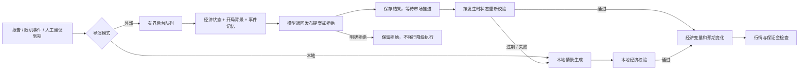

# Agent 模式与人工事件建议（v0.4）

外部 Agent 的后端调用、后台队列、校验和降级已经实现，支持 **OpenAI 兼容的 Chat Completions API**。未提供 API Key 的当前环境仍使用本地导演；测试用替代响应验证完整流程，没有声称已验证真实模型认证或效果。

## 稍后如何接入 API

本地开发复制根目录 `.env.example` 为 `.env`，填写下列服务器配置。云环境则在环境设置中配置同名密钥/变量，并允许实际供应商域名的 HTTPS 访问。当前云环境未配置模型密钥或模型服务域名；稍后确定供应商后再配置。

```dotenv
AGENT_API_KEY=你的服务器密钥
AGENT_BASE_URL=https://api.openai.com/v1
AGENT_MODEL=实际可调用的模型名称
AGENT_MODE=external
AGENT_RESPONSE_FORMAT=json_schema
AGENT_TOKEN_PARAMETER=max_completion_tokens
```

- 基地址填写 API 根路径，程序追加 `/chat/completions`；只接受 HTTPS，不接受 URL 内嵌用户名、密码、查询参数或片段。
- 支持 Structured Outputs 的模型使用 `json_schema`；其他兼容供应商可改成 `json_object`。两者都经过相同的本地严格校验。
- 部分兼容供应商需要 `AGENT_TOKEN_PARAMETER=max_tokens`；每次响应上限 1,600 completion tokens。若模型把预算大量用于推理而截断输出，会触发无效响应处理，应选择适合短结构化输出的模型。
- `AGENT_MODE=local` 表示默认本地运行，配置完成后在页面「世界导演 → 外部 Agent」手动切换；`external` 表示配置完整时新局默认外部模式。缺失或错误配置会显示原因并使用本地模式，不发网络请求。
- 重启 `npm run dev` 或 `npm start` 加载配置，创建新局。看到“已配置”只表示服务器配置完整，第一次实际事件任务才验证远端认证。
- 适配器使用服务器 `undici` 和 `EnvHttpProxyAgent`，遵守环境代理和 CA 信任。密钥仅进入服务器 Authorization 头；不通过网页表单、URL、Snapshot 或离线 HTML 传递。
- 原生 Claude Messages / Gemini 协议不是这个适配器的协议；可通过同样的 `AgentProvider` 接口增加适配器，或使用提供 OpenAI 兼容端点的服务。

**单文件 HTML 保持离线模式。** 它能继续交易、查看历史、做教程和提交本地事件建议，但外部 Agent 需要运行项目后端，不把 API Key 放进下载文件。

## 工作流



1. 每 3 个游戏小时的报告、随机突发事件和到期人工建议使用同一入口。**浏览器每秒轮询报价不会调用模型**。
2. 外部请求放入独立后台队列，网络等待不占用交易串行锁。期间开仓、平仓、时间推进继续运行。
3. 网络响应返回时仅提交短暂的任务状态更新，不立即改行情。暂停期间只显示“等待推进校验”；下一次游戏时间前进后才发布。
4. 发布前再次校验经济体、类型、主题、当前指标预期、范围、最大差值和人工方向/强度。不会把旧模型预测直接平移到新状态。生成观察距发布超过 180 个游戏分钟也视为过期。
5. 成功事件标记 `generator=external`；降级事件标记 `fallback`。事件关联任务 ID 和人工建议 ID，任务保存简短依据。未发布的模型正文不会提前返回客户端。
6. 模型明确拒绝、供应商 refusal 或内容过滤时保留拒绝，不替玩家强行执行。拒绝不会因为放置过久而转成降级事件。
7. 取消建议、切换本地模式、删除/过期会话和关闭服务器都会中止相应生成任务，晚到结果不生效。模式切换时正在生成的人工建议恢复为等待，由当前模式在下一次到期检查时处理；取消建议则永久取消。

## 成本和故障边界

| 项目               | 默认行为                                                                 |
| ------------------ | ------------------------------------------------------------------------ |
| 每次请求超时       | 10 秒，涵盖连接和整个响应体                                              |
| 重试               | 最多 1 次，指数退避；可配置 0–2 次                                       |
| 可重试情况         | 网络错误、超时、5xx、短暂 429、无效结构/数值；无效输出重试时加入修正提示 |
| 不重试             | 认证/权限错误、配置不兼容、取消、预算不足                                |
| Retry-After        | 遵守供应商冷却时间；需要等待超过 3 秒则当前任务降级，不提前重试          |
| 连续失败           | 连续 3 个失败任务后至少冷却 60 秒；已有更长限流窗口继续保留              |
| 全服务器额度       | 每真实分钟最多 6 次 HTTP 尝试，包含重试，所有会话共享                    |
| 全服务器并发       | 最多 2 个生成调用                                                        |
| 单会话队列         | 最多 4 个待处理外部任务，单会话同时 1 个网络生成                         |
| 单会话外部任务总量 | 最多 100 个，超限使用明确标注的本地降级                                  |
| 总任务截止         | 根据请求超时与重试计算，最多 120 秒；提供器不配合 Abort 时仍会结束等待   |
| 响应大小           | 最多 64 KiB，流式计数；不接受截断完成                                    |
| 人工建议           | 每局最多 50 条，同时最多 5 条排队/生成中                                 |
| 任务记录           | 内存保留最近 24 条；页面展示最近 8 条                                    |

可配置项见 `.env.example`：`AGENT_TIMEOUT_MS`、`AGENT_MAX_RETRIES`、`AGENT_REQUESTS_PER_MINUTE`、`AGENT_MAX_CONCURRENT`。上游原始错误体不读取/记录，统一使用安全错误码。HTTP 跳转被拒绝，避免 Authorization 跟随到另一端点。成功正文若回显当前密钥也会拒绝。

## 模型输入与输出

输入通过字段白名单投影构造：目标经济体及最多六个贸易伙伴、指标和结构、世界能源/风险、近期事件、开局模拟背景，以及人工文字与结构化设置。标注历史基准年份与假设字段。不会序列化整个 Session，不含账户、持仓、未来随机数或密钥。

系统规则与用户数据分开；玩家背景、已有标题、事件文字都是不可信数据，不能替换规则。模型仅提出经济指标变化，不能直接设置汇率、余额、奖励或提前执行央行决议。价格仍由经济引擎计算。结构校验与量化边界不能保证叙事的经济学判断完全准确，模型参数也仍未完成历史校准。

返回格式：

```json
{
  "decision": "publish",
  "event": {
    "economy": "EUR",
    "kind": "surprise",
    "topic": "supply",
    "expected": 10,
    "actual": 12,
    "title": "模拟港口延误增加交付压力",
    "description": "模拟企业交付周期延长，供给压力先进入进口成本，再逐步影响通胀预期。"
  },
  "reason": "供应约束与当前进口依赖相符，但不预设汇率方向。"
}
```

这里的 `expected=10` 只是格式示例，真实调用必须采用 prompt 中的当前预期。拒绝格式为 `{"decision":"reject","event":null,"reason":"简短经济理由"}`。`reason` 是简短依据，不是内部推理轨迹。

支持通胀、增长、工业、信贷、供应、信心、能源、财政八类主题。人工“上升”指经济指标；能源影响全球，财政余额上升表示赤字减少或盈余增加。轻微/中等分别限制为主题全局变化上限的 30%/65%。矛盾的文字或方向可由模型拒绝。

## 代码入口与验证

- `apps/server/src/agent-config.ts`：服务器配置验证。
- `apps/server/src/agent-http.ts`：OpenAI 兼容协议、限额、超时、重试、冷却、响应大小和错误脱敏。
- `apps/server/src/agent-queue.ts`：后台生成队列、取消、晚到结果处理。
- `apps/server/src/session.ts`：游戏时钟、发生时重新校验、降级、模式切换与会话清理。
- `packages/agents/src/protocol.ts`：模型上下文投影、提示词、JSON Schema 和经济校验。
- `apps/web/src/components/AgentPanel.tsx`：配置状态、模式切换、任务与降级记录。

`AgentProvider.generate(observation, context, signal)` 是外部适配器接口。旧 `ScenarioProvider.propose` 保留给本地提供器，不要把慢网络塞进旧同步路径。

```bash
npm test
npm run build
npm run test:e2e
npm run test:offline
```

测试通过真实 Session、HTTP 适配器、路由和前端调用链，用替代模型响应覆盖慢响应、交易不中断、过期、取消、拒绝、错误输出、限流、凭据回显和断网下载版。真实供应商联调等提供 API 配置后进行。当前任务、记忆、调用额度和会话都保存在进程内存中，重启会清除；多进程共享额度和持久化不在此原型中。
