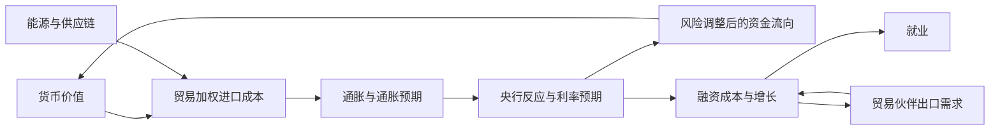

# 当前版本如何更新时间与价格

## 时间：1× 与现实等速

默认暂停，点击开始后按 `performance.now()` 的实际经过时长推进：

`模拟经过秒数 = 现实经过秒数 × 当前速度`

可选择 1×、5×、15×、60×、300×。定时器每 250 ms 唤醒一次，但并不把一次唤醒当作固定的五分钟。不足一秒的部分累计保留，迟到的回调补算真实经过的时间；变速前先按旧速度结算，暂停期间不推进。客户端每秒读取状态，成交前也会同步时钟。

模拟世界仍从自己的第 1 天 09:00 开始，等速不代表它连接了真实市场或使用现实日期。

市场按模拟秒逐步执行，加速只增加执行步数。五分钟 K 线覆盖 300 个模拟秒，尚未结束的蜡烛会持续更新；它不是刷新速度。每秒检查保证金、价格和事件，快进也不跳过这些步骤。事件概率按模拟时间计算，与网页刷新次数无关。

## 价格：目前完全由程序计算

正常应用由服务端推进，前端读取结果；离线 HTML 在浏览器运行同一个 Session 和引擎，没有真实行情接口、没有外部 LLM 调用。

每种非美元货币保存一个美元价值。价格变化有两部分：

- **缓慢漂移**：本国与美国的政策利率预期差、相对通胀、风险调整后资金流向、贸易压力和增长预期。
- **随机波动**：共同美元因素、共同风险因素、欧洲区域因素，以及该货币独有的扰动；再乘以该货币波动参数与全局波动状态。

随机波动按经过时间的平方根缩放，漂移按经过时间线性缩放。当前系数为演示参数，不能认为已被真实历史验证。

## 已存在的联系

1. **共同因素**：各货币共享同一时刻的美元、风险和区域冲击。不同风险系数意味着它们可能同向或反向变化。
2. **美元基准**：`EUR/JPY = EUR/USD ÷ JPY/USD`。日元或欧元的基础价值变化，会同步反映在相关交叉货币对上。
3. **事件 → 经济状态 → 价格**：事件提议通过校验后，改变通胀、增长、信心、压力和利率预期；预期差与经济状态决定一次重估及后续漂移。
4. **压力 → 交易成本**：压力与波动状态升高会扩大点差，改变可成交价格、浮动盈亏和保证金风险。

当前报告每三个模拟小时安排一次，以经济影响权重选择经济体。较小经济体独立事件较少，但仍共享全球冲击。突发事件按模拟秒抽样；美元事件会同时改变所有非美元货币的美元价值。

## 新增的经济反馈链

报价按秒变化，宏观状态按整小时、带不同滞后速度更新。所有经济体读取同一份上小时状态，贸易伙伴不会因为计算顺序不同而提前收到信号。

| 环节       | 实现                                                                                       |
| ---------- | ------------------------------------------------------------------------------------------ |
| 进口成本   | 伙伴货币相对本币升值、能源变贵或供应链受阻，会推高进口成本目标；指数缓慢向目标靠近         |
| 通胀与增长 | 成本压力、需求信号、实际利率与贸易伙伴增长共同影响目标值，不按新闻直接瞬间修改 GDP         |
| 就业       | 增长与潜在增长的差距缓慢影响失业率，响应速度比市场报价更慢                                 |
| 政策       | 通胀目标、增长缺口和中性利率影响政策预期；实际利率只在本国会议时间调整，每次最多 50 个基点 |
| 资本       | 比较预期实际收益，扣除风险溢价，并计入避险偏好；高利率且高通胀/高风险的经济体仍可能流出    |
| 汇率反馈   | 资金流向与贸易压力影响下一步货币价值变化，完成反馈链                                       |
| 全球能源   | 商品出口方和能源进口方的价格、贸易条件与成本出现不同响应                                   |

默认价格为 100 的指数、正负资金流指数和贸易压力指数都是模拟指标，不代表真实资金量、GDP 占比或国际收支数额。贸易权重是按经济规模、区域与预设贸易联系构造的模型配置，实际利率会议日历也不是现实央行日历。

## 事件与 Agent 的边界

报告扩展为通胀和增长预期调查；突发事件包括供应链、信心与全球能源。Agent 的输入包括当前状态、贸易网络、能源价格、风险偏好与近期事件，可据此选择不同话题。Agent 不能直接下达价格、任意宏观状态修改、提前的央行决议或交易指令。

不同事件仅允许规定的值域和变动幅度，公布预期必须与当前状态一致。通过校验后，引擎按明确渠道改变状态与价格，并生成可查看的传导解释。央行决议由经济模块在会议时计算和发布。

当前仍是本地情景导演，不包含外部大模型调用。模型 API 的异步接入、预算和超时回退尚待实现；不会把代码模板称为大模型推理。

## 验证与剩余限制

对照测试覆盖贬值引起的成本与政策预期变化、贸易伙伴衰退传导、能源进口/出口差异、高名义利率下的资金外流、资金流反馈到价格、会议边界、就业时滞与更新顺序独立性。另有 90 个游戏日的宏观数值稳定性测试，以及不同运行速度下跨小时状态一致性测试。

这些测试证明已实现的关系和数值约束，不证明模型已拟合真实市场。真实历史校准、完整国际收支/银行资产负债表、财政与政治部门、真实订单流和挂单/融资成本仍未完成。开局参考行情适配器已实现，待配置账户联调；它只替换开局汇率，不校准其他参数，也不提供实时盘中行情。

## 30 经济体版本

默认开局改为带出处的 2023 年世界银行年度基准，加有界的相关扰动。实体、金融和财政指标逐小时更新，逐日形成各国内部观察。国家数、数据口径、初始扰动与新传导渠道见 [world-baseline.md](world-baseline.md)。
